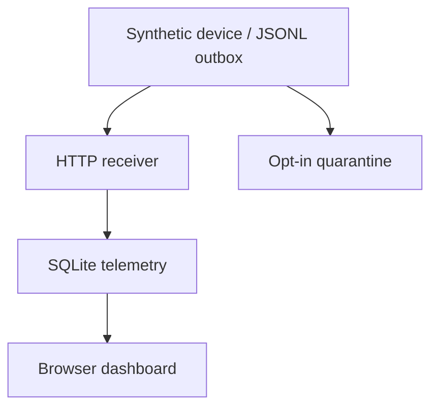

# EdgeWatch — IoT telemetry and replay monitor

A runnable software-only device-monitoring project: a synthetic ESP32-like
producer sends readings through an HTTP API into SQLite; a browser dashboard
shows recent readings and threshold alerts. Alerts are deterministic rules, not ML predictions.

## Run (Python 3.10+, standard library only)

From the repository root:

```bash
cd edgewatch-iot
export EDGEWATCH_KEY="$(python -c 'import secrets; print(secrets.token_hex(24))')"
python app.py
```

In another terminal, set **the same** EDGEWATCH_KEY, then:

```bash
cd edgewatch-iot
python replay.py --seed
```

Open http://127.0.0.1:8080, enter the API key, and select Refresh telemetry.
The seed produces 10 synthetic readings: one high-temperature and one
low-voltage alert. Restart the receiver to verify readings persist.

## Failure demo

1. Stop the server; run `python replay.py --seed --outbox offline.jsonl`.
2. The connection fails; the outbox retains all 10 readings.
3. Restart the server; run `python replay.py --outbox offline.jsonl`.
4. Already accepted sequences are acknowledged without duplicate rows.
5. Reusing a sequence with changed measurements is rejected.

The producer removes acknowledged lines by replacing its outbox. If it crashes
after server acceptance but before replacement, replay is safe because the
server's `(device, seq)` key is unique. Use one producer per outbox. Sequence
numbers must persist across device restarts in a real adapter. By default, a permanent HTTP 400/413 rejection stops replay and preserves
that record and everything after it. To explicitly quarantine permanently
rejected records and continue with later valid readings, use:

```bash
python replay.py --outbox offline.jsonl --quarantine rejected.jsonl
```

The quarantine JSONL records the original telemetry line and HTTP status.
Treat it as sensitive operational data; do not commit it. Newly created
quarantine files use owner-only permissions on POSIX. A failed quarantine
write leaves the outbox intact, and 401/403 authentication, 409 concurrency,
429 rate-limit, and 5xx errors always stop replay without quarantine.
Quarantine is not exactly-once: a crash after appending to quarantine but
before rewriting the outbox may produce a duplicate quarantine entry.
Review and repair rejected records before reintroducing them to the outbox.

## Architecture and constraints

Producer JSONL outbox → authenticated HTTP receiver → SQLite → dashboard.
The API caps request bodies at 4 KiB, validates finite numeric measurements,
requires timezone-aware timestamps, and retains the newest 200 rows in the UI.
The database retains all rows; retention is not implemented. Dashboard keys
remain in memory, with no browser storage. The HTTP server binds localhost.

This is a local development server, not an internet deployment. TLS, per-device
identity, rate limits, request deadlines, fleet provisioning, MQTT, retention,
physical sensors and load testing are not implemented. The outbox is file-based
and single-writer; SQLite serializes writes, and concurrent retries can receive
a conflict response. Thresholds (60°C / 3.2V) are illustrative, not battery safety
recommendations. No physical actuator control is performed.

## Verify

```bash
python -m unittest discover -s . -v
```

Run this from the repository root. Ten tests cover replay, conflicts, alerts, invalid inputs, restart persistence,
real HTTP/outbox authentication, quarantine, and failure preservation.

## Interview walkthrough

Show a reading in the dashboard, stop the server, retain an outbox, restart and
replay it. Explain why HTTP acknowledgment alone cannot guarantee exactly-once
transport, and how an idempotency key provides one stored row per device event.
Then discuss permanent-failure handling and migrating to per-device credentials.

## Architecture



## Provenance

See [PROVENANCE.md](PROVENANCE.md) for the exact upstream snapshot and file mapping.
The existing upstream license is retained unchanged; no new license grant is introduced.
